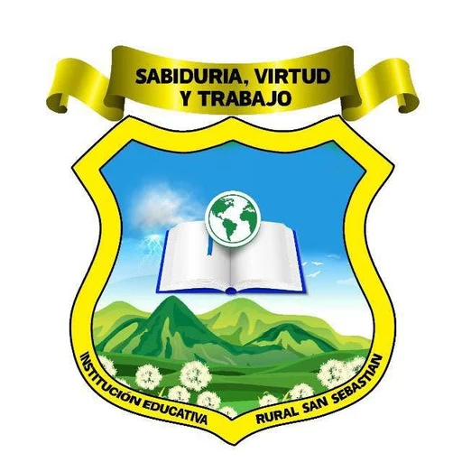

<div align="center">



# Eventos · IER San Sebastián

**Institución Educativa Rural San Sebastián**
Hacarí, Norte de Santander — Colombia

*«Sabiduría, Virtud y Trabajo»*

[](https://tarra-nine.vercel.app)


</div>

---

## 📌 Sobre el proyecto

Página web que reúne los **eventos institucionales** de la IER San Sebastián y sus **19 sedes** rurales en Hacarí: actos culturales, gobierno escolar, salidas pedagógicas, jornadas de campo, ferias, deportes y fechas especiales del calendario escolar.

Cada evento tiene su propia galería de fotos y, cuando existen, los videos publicados por la institución en TikTok. La página usa los colores del escudo y está pensada para verse bien en celular, tablet y computador.

> 🌐 **Página publicada:** https://tarra-nine.vercel.app

## ✨ Qué encuentras en la página

- 🎬 **Portada de la sede** con slider de fotos (se puede pausar) y video de la institución con control de sonido.
- 🗂️ **33 eventos** del año escolar 2026 con **más de 470 fotos** y **23 videos** de TikTok.
- 🔎 **Buscador de eventos** y **filtro por categoría**.
- 🖼️ **Visor de fotos** por evento: anterior / siguiente con botones o con las flechas del teclado, y `Esc` para cerrar.
- 📱 **Diseño adaptable**, con menú para celular e imágenes livianas en formato WebP (cada foto tiene su miniatura).
- 🔗 Enlaces a las redes oficiales de la institución.

## 🗓️ Eventos publicados

| Fecha | Evento | Categoría |
|:-----:|--------|-----------|
| 25 feb 2026 | Elecciones escolares 2026 | Gobierno escolar |
| 26 feb 2026 | Rendición de Cuentas 2025 | Gobierno escolar |
| 08 mar 2026 | Día de la Mujer | Comunidad |
| 10 mar 2026 | Posesión de Personera y Contralor Estudiantil | Gobierno escolar |
| 19 mar 2026 | Día del Hombre | Comunidad |
| 19 mar 2026 | Media Rural con Futuro | Emprendimiento |
| 08 abr 2026 | Jornada ambiental: clima, dengue y residuos | Medio ambiente |
| 09 abr 2026 | Educar para la paz: Día de la Memoria | Comunidad |
| 19 abr 2026 | Del grano a la taza: salida pedagógica del café | Campo |
| 23 abr 2026 | Día del Idioma en nuestras 19 sedes | Cultura |
| 25 abr 2026 | Cierre del primer período y Escuela de Padres | Comunidad |
| 25 abr 2026 | Día del Niño en nuestras sedes | Comunidad |
| 29 abr 2026 | Día de la Tierra y Día del Árbol | Medio ambiente |
| 05 may 2026 | Salida pedagógica a la UFPS Ocaña | Académico |
| 13 may 2026 | Jornada de vacunación porcina | Campo |
| 15 may 2026 | Día del Maestro | Comunidad |
| 03 jun 2026 | Día de la Afrocolombianidad | Cultura |
| 09 jun 2026 | Olimpiadas Matemáticas UIS: fase final | Académico |
| 10 jun 2026 | Laboratorio de análisis de suelos | Campo |
| 06 jul 2026 | Regreso a clases: segundo semestre | Comunidad |
| 08 jul 2026 | Encuentro por la educación del Catatumbo | Comunidad |
| 14 jul 2026 | Competencias deportivas | Deportes |
| 20 jul 2026 | Día de la Independencia de Colombia | Cultura |
| 24 jul 2026 | Preparación para las Pruebas Saber 11 | Académico |
| 30 jul 2026 | Jornada de porcicultura | Campo |
| 07 ago 2026 | Conmemoración del 7 de agosto | Cultura |
| 28 ago 2026 | Apicultura en Montaña Dorada | Campo |
| 03 sep 2026 | English Day | Académico |
| 25 sep 2026 | Feria de Emprendimiento | Emprendimiento |
| 25 sep 2026 | Reinado del Reciclaje 2026 | Medio ambiente |
| 27 sep 2026 | Feria Agropecuaria en el Colegio San Miguel | Campo |
| 06 oct 2026 | XI Festival de Danzas Intercolegiadas | Cultura |
| 12 oct 2026 | Día de la Diversidad Étnica y Cultural | Cultura |

## 📁 Contenido del repositorio

Este repositorio guarda **solo la página ya compilada**, lista para publicarse (el código fuente se trabaja aparte).

```text
Tarra/
├── index.html          → Página principal
├── assets/             → JavaScript, estilos y tipografías ya compilados
├── medios/
│   ├── logo.webp       → Escudo de la institución
│   ├── logo-icono.png  → Ícono de la pestaña del navegador
│   ├── sede/           → Fotos del slider y video de la sede
│   └── eventos/
│       └── <evento>/   → Fotos de cada evento
│           └── mini/   → Miniaturas para cargar más rápido
├── docs/               → Imágenes de este README
└── vercel.json         → Encabezados de seguridad y caché para Vercel
```

## 🚀 Publicación

La página se publica en **Vercel** como sitio estático: cada cambio que llega a la rama `main` se despliega automáticamente en https://tarra-nine.vercel.app.

`vercel.json` agrega encabezados de seguridad (Content-Security-Policy, HSTS, X-Frame-Options, entre otros) y define la caché: un año para `assets/` y un día para `medios/`.

### Verla en el computador

La página necesita abrirse desde un servidor (no con doble clic en `index.html`). Desde la carpeta del repositorio:

```bash
npx serve .
```

y luego abrir la dirección que aparece en la consola (por defecto `http://localhost:3000`).

## 📲 Redes de la institución

- **TikTok:** [@iersansebastian](https://www.tiktok.com/@iersansebastian)
- **Facebook:** [Ier San Sebastián](https://www.facebook.com/IERSanSebastian)
- **Instagram:** [@ier_sansebastian](https://www.instagram.com/ier_sansebastian)

Las fotos y videos de los eventos pertenecen a la Institución Educativa Rural San Sebastián y fueron tomados de sus redes oficiales.

---

<div align="center">


**Desarrollado por Ing. Carlos**

<sub>Logo diseñado por <b>Lisney Tatiana Acevedo</b></sub>

</div>
